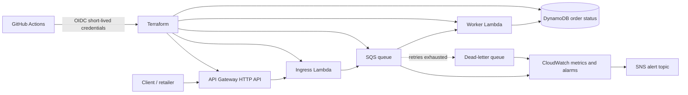

# QueueGuard — AWS Serverless Reliability Platform

QueueGuard is a portfolio-ready, event-driven order-processing reference architecture. It accepts order events through API Gateway, places them on SQS, processes them with Lambda, stores status in DynamoDB, and sends failed messages to a dead-letter queue (DLQ). CloudWatch alarms and an SNS topic provide operational visibility.

## Why this project
A retailer needs to accept work even when a downstream processor is temporarily failing. Queueing decouples request intake from processing, retries absorb transient failures, and a DLQ preserves repeatedly failing events for investigation.

## Architecture


## AWS services
- API Gateway HTTP API: public HTTPS endpoint for order submission.
- AWS Lambda: lightweight ingress validation and asynchronous processing.
- Amazon SQS + DLQ: buffering, retries and failed-message isolation.
- DynamoDB: stores order status with on-demand capacity.
- CloudWatch: logs, metrics, alarms and retention.
- SNS: email notifications for alarms (subscribe your email after deployment).
- IAM: separate least-privilege execution roles.
- KMS: SQS server-side encryption with an AWS-managed key.
- AWS Budgets: optional budget alert, configured separately because budgets are account-level.

## Repository layout
```text
.
├── .github/workflows/
│   ├── terraform-ci.yml
│   └── deploy.yml
├── app/
│   ├── ingress.py
│   └── worker.py
├── modules/
│   └── queueguard/
│       ├── main.tf
│       ├── variables.tf
│       └── outputs.tf
├── environments/dev.tfvars
├── scripts/smoke-test.sh
├── main.tf
├── variables.tf
├── outputs.tf
├── versions.tf
└── README.md
```

## Deployment prerequisites
This repository cannot safely deploy to an AWS account from a GitHub push alone until you configure account-specific trust and Terraform state. **Zero-cost guarantee:** a real AWS deployment cannot be guaranteed to cost $0 across all accounts/regions/free-tier plans. For strict $0, keep the AWS deployment workflow unused and use GitHub Actions for Terraform validation only. One-time setup:
1. Create an S3 bucket for Terraform state in your AWS account. Enable versioning and block public access. Use a unique bucket name.
2. Create an AWS IAM role trusted by GitHub OIDC for **your repository only**. Grant it the permissions needed to manage the resources in this project and access the state bucket. Do not create long-lived AWS access keys.
3. In GitHub, add the repository secret `AWS_ROLE_ARN` and repository variable `AWS_REGION`. The backend bucket is configured in `versions.tf`; the workflow does not create the state bucket.
4. Edit `main.tf` backend bucket value to your state bucket, or replace the backend with a workspace-specific backend file. Backend bucket names must be known before `terraform init`.
5. Set GitHub Actions permissions and protect `main` with branch protection and required reviews if working with collaborators.
6. Push to `main` for CI validation. AWS deployment is **manual only**: run the `Deploy QueueGuard` workflow from the Actions tab when you intentionally want to create billable resources. Review the plan first and do not run apply if you require guaranteed $0 AWS spend.

**Cost warning:** AWS resources can incur charges. API Gateway, CloudWatch logs/alarms, S3 state storage/requests and other usage are not guaranteed free for every account. AWS Budgets can alert but do not automatically stop all resources. For a strict $0 project, do not deploy the AWS stack; the public GitHub repository and GitHub Actions validation can be used without AWS resources. If you choose to deploy, check your account-specific Free Tier/credits and regional prices, create a budget alert first, and destroy the stack after testing.

## API
`POST /orders`
```json
{
  "order_id": "order-1001",
  "customer_id": "customer-42",
  "items": [{"sku": "book-1", "quantity": 2}]
}
```
Returns `202 Accepted` when the event has been queued. The worker stores a `PROCESSED` status in DynamoDB. This is a learning reference, not a payment or inventory system; it does not implement authentication, idempotency guarantees, PII handling, or a real order database.

## Test
After deployment:
```bash
curl -X POST "$(terraform output -raw api_url)orders" \
  -H 'content-type: application/json' \
  -d '{"order_id":"order-1001","customer_id":"customer-42","items":[{"sku":"book-1","quantity":2}]}'
```
The response should be `202`. Check the worker's CloudWatch log group and DynamoDB table for the processed order. `scripts/smoke-test.sh` provides a simple repeatable check.

## Security and reliability controls
- GitHub OIDC uses short-lived credentials; no AWS keys are stored in GitHub.
- Lambda roles are separate and scoped to required resources.
- SQS encryption, DynamoDB encryption at rest, and HTTPS API endpoint.
- SQS redrive policy sends repeatedly failing events to a DLQ.
- CloudWatch logs have configurable retention.
- CloudWatch alarms monitor queue depth and DLQ depth.
- Terraform state is expected to live in versioned, private S3 storage.
- Terraform CI validates changes before deployment.

## Disaster recovery runbook
1. Inspect CloudWatch alarms and Lambda error logs.
2. Check queue depth, DLQ depth and worker concurrency/throttling.
3. Fix the underlying code/configuration and deploy via reviewed GitHub change.
4. Redrive DLQ messages only after validating the failure cause; test with a small batch first.
5. If the region is unavailable, restore from versioned Terraform state and redeploy in a second region after adapting state/backend and resource names. DynamoDB/SQS are regional in this starter; cross-region recovery is a documented extension, not automatically enabled.

## 2–4 week build plan
- Week 1: understand the diagram, configure OIDC/state, deploy infrastructure.
- Week 2: exercise API, queue retries, DLQ and logs; add tests.
- Week 3: security review, alarms, cost budget and recovery runbook.
- Week 4: add screenshots, architecture decision records, and a demo video.

## Resume bullets
Use only after you have deployed and tested the project:
- Built an event-driven AWS order-processing platform using API Gateway, Lambda, SQS, DynamoDB and Terraform.
- Automated infrastructure validation and deployment with GitHub Actions and GitHub OIDC, avoiding long-lived AWS credentials.
- Implemented retry/DLQ handling, CloudWatch alarms, encrypted queues and scoped IAM roles to improve failure isolation and operational visibility.
- Documented incident triage, DLQ recovery, cost controls and a regional disaster-recovery approach.

## Limitations / next steps
This is a deliberately small fresher-level reference architecture. Before production business use, add request authentication (for example JWT authorizer), idempotency and duplicate handling, input schema validation, WAF/rate limits where appropriate, alarm delivery confirmation, cross-region data recovery, integration tests, and security review. “Production-style” does not mean independently audited or suitable for handling real customer data without those steps.
